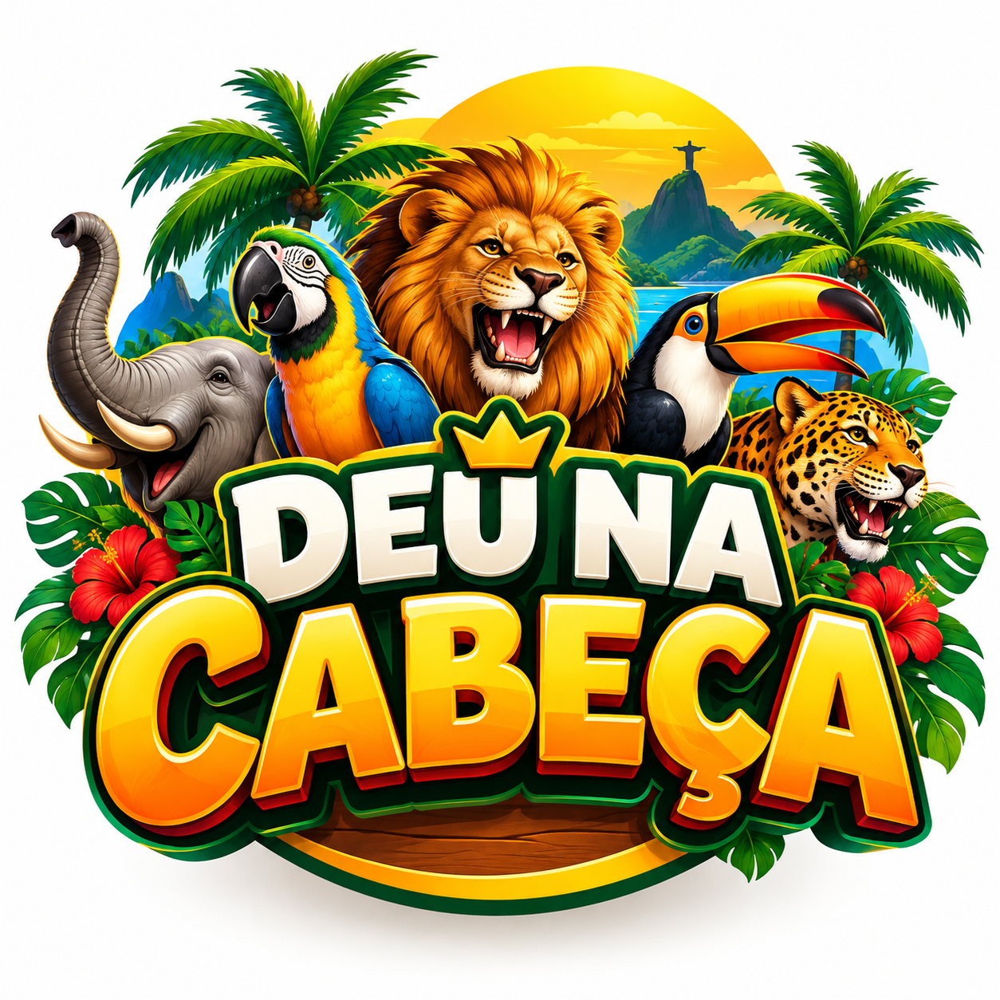

# Deu na Cabeça

Portal de consulta dos resultados do **PT Rio**, feito em **Laravel 12 e PHP 8.2+**. A identidade visual combina a logo original com verde floresta, amarelo e laranja, tipografia sem serifa e uma tabela interativa dos 25 bichos.

<p align="center">
  
</p>

## O que o site oferece

- Dois quadros gratuitos do Rio de Janeiro: os prêmios da extração indicada pela fonte e o resumo das extrações publicadas.
- Atualização dos quadros pelo fornecedor a cada minuto e botão para recarregar.
- Tabela dos 25 bichos com busca por nome, grupo ou dezena.
- Favoritos salvos no navegador e detalhes de cada grupo.
- Layout adaptado a computadores e celulares.

## Requisitos

- PHP 8.2 ou superior, com as extensões exigidas pelo Laravel e `pdo_sqlite`.
- Composer 2.
- Extensão PHP `zip` habilitada ou um descompactador compatível disponível para o Composer.
- Git e acesso à internet para instalar as dependências e carregar os widgets.

A interface ativa usa Blade, CSS e JavaScript em `public/`; não exige Node.js nem build npm para executar.

## Instalar

Depois de clonar o repositório, entre na pasta e execute:

```sh
composer run setup
php artisan serve --host=127.0.0.1 --port=8000
```

O comando `setup` instala as dependências, cria `.env` a partir de `.env.example` se necessário, gera a chave da aplicação, cria o banco SQLite local, executa as migrations e compila os templates Blade.

Abra **http://127.0.0.1:8000**.

### Iniciador para Windows

Depois da instalação, também é possível manter o servidor em segundo plano:

```powershell
powershell -NoProfile -ExecutionPolicy Bypass -File .\start-local.ps1
```

O iniciador reutiliza a porta 8000 quando já está ocupada. PID e logs próprios ficam em `.local/`. Não é necessário manter um agendador de resultados.

## Fonte dos resultados

A apresentação dos resultados vem dos [widgets gratuitos do eojogodobicho.com](https://www.eojogodobicho.com/widget.html), incorporados diretamente em iframes. Não é exigido cadastro, assinatura ou chave de API para usar essa integração. O crédito da fonte permanece visível.

**Confira a data e a extração dentro de cada quadro.** O quadro detalhado e o resumo podem mostrar extrações diferentes. A disponibilidade, a precisão e o prazo de publicação dependem do fornecedor. Há um link para abrir a fonte diretamente caso os widgets não carreguem.

O Laravel não recebe nem armazena os números dos widgets e não oferece uma API JSON própria de resultados. O navegador de cada visitante precisa acessar o domínio externo.

## Configuração e identidade

- `config/bicho.php`: endereços dos widgets do Rio e da fonte.
- `config/brand.php`: nome e caminho da logo.
- `public/images/deu-na-cabeca.png`: logo original usada no site.
- `public/css/app.css`: cores, tipografia e layout.
- `.env.example`: exemplo de configuração sem credenciais.

O arquivo `.env`, dependências em `vendor/`, bancos SQLite, logs, sessões, caches e artefatos locais ficam fora do repositório.

## Verificação

```sh
php artisan test
php artisan view:cache
```

Verificação opcional de sintaxe JavaScript, com Node.js instalado:

```sh
node --check public/js/app.js
```

A suíte PHP cobre os widgets e créditos na página, ausência de consultas externas do backend e retirada da antiga API e do agendador. A interface também foi verificada no Edge em computador e celular.

## Publicar o site

Hospede em um serviço compatível com Laravel/PHP, apontando a raiz web para `public/`. Configure HTTPS, `APP_ENV=production`, `APP_DEBUG=false` e `APP_URL` no ambiente da hospedagem. Se houver uma Content Security Policy, permita `https://www.eojogodobicho.com` em `frame-src`.

O servidor PHP integrado e o iniciador Windows são destinados ao desenvolvimento local. Publicar o código no GitHub não hospeda a aplicação Laravel.

Mais detalhes em [PROJETO.md](PROJETO.md).
